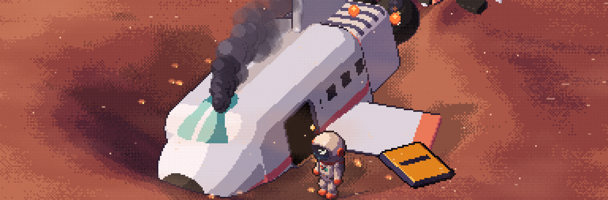
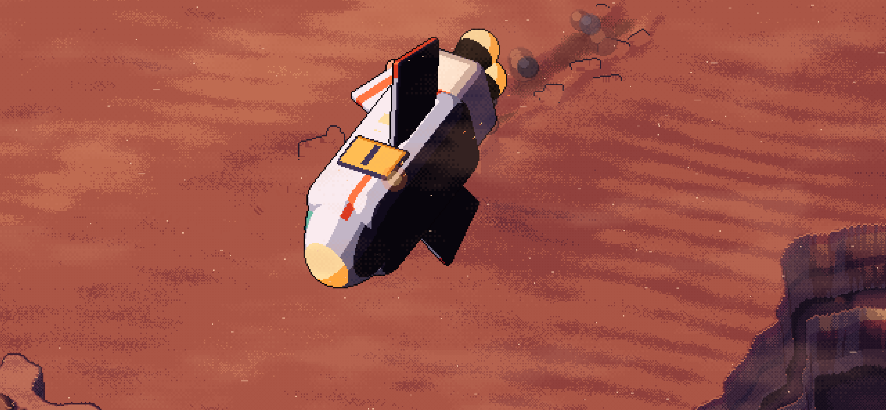
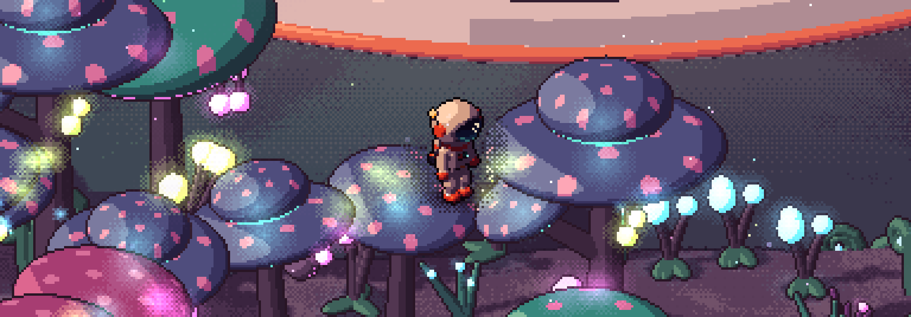
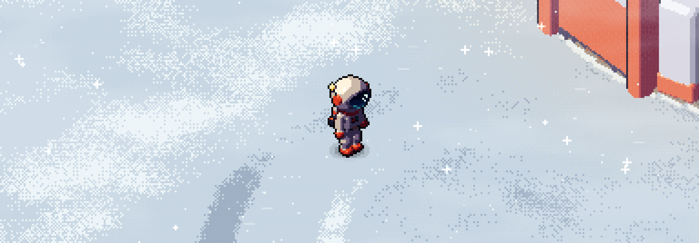
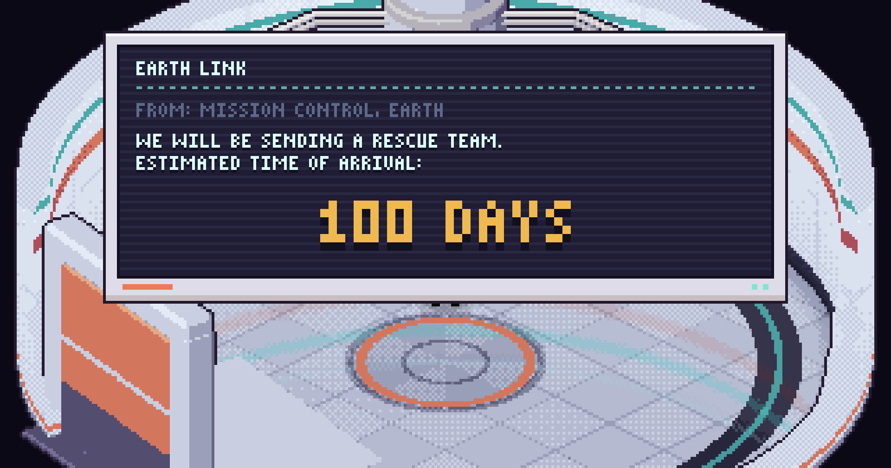
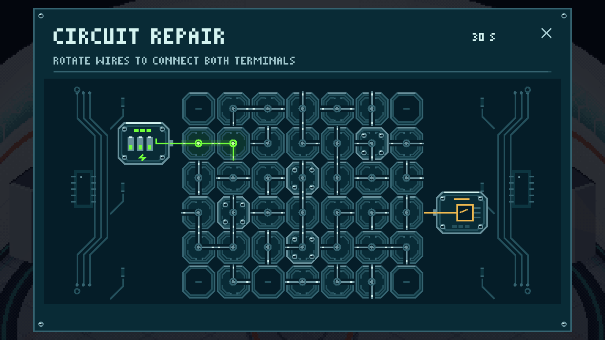
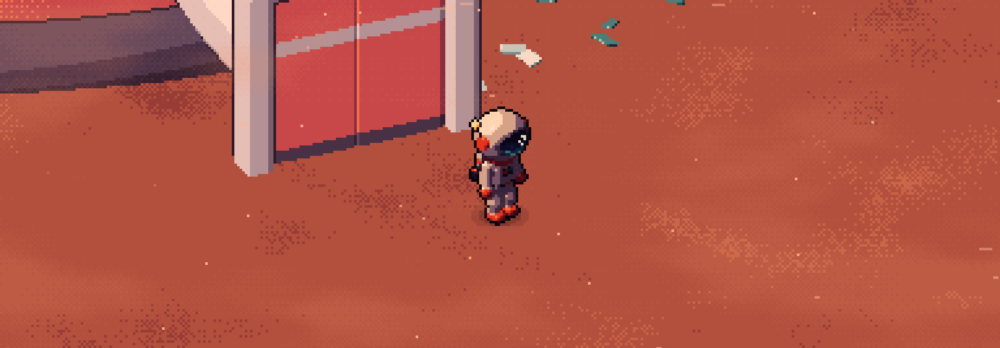
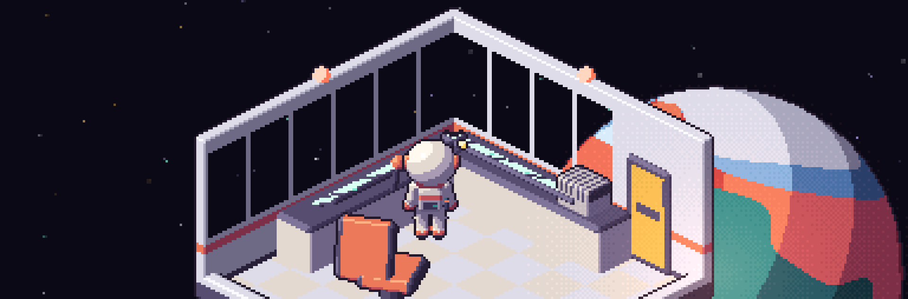

<div align="center">



# 🪐 GTFO &nbsp;·&nbsp; Great Time For Oxygen

### Survive the red planet. Repair the base. Call home.

*A cozy isometric pixel-art survival game, made by **Team Araxys** for the **NASA Space Apps Challenge**.*

[](https://www.spaceappschallenge.org/)
[](#-team-araxys)
[](https://godotengine.org/)
[](https://gtfo-araxys.vercel.app)

[](https://gtfo-araxys.vercel.app/play/)
[](https://gtfo-araxys.vercel.app/#download)
[](https://gtfo-araxys.vercel.app/#download)

### 🌐 **[gtfo-araxys.vercel.app](https://gtfo-araxys.vercel.app)** &nbsp;— the landing page, downloads and browser version

</div>

---

## 🛰️ The challenge

> **NASA Space Apps Challenge · Challenge #03: Build a Junior Astronaut Mission Trainer** *(Games, Software)*

The brief asks for an interactive game that lets young players manage a lunar or Martian outpost: life
support, radiation protection, power and food, with communication delays and trade-offs between them,
using NASA open data wherever possible.

GTFO is our answer. You are an astronaut on a broken outpost and every system is something you fix and
keep running yourself: you restore **oxygen**, bring back **power** by aligning solar mirrors, grow **food
and water**, shelter from **radiation**, and send an SOS that takes real time to reach Earth. Radiation
warnings follow archived solar-flare and particle events from **NASA's DONKI database**.

## 🌌 The game

The crew before you built a base on the planet **Araxys** and then went silent. Your ship doesn't survive
the landing, and everything after that is up to you.

| | |
|---|---|
| 🚀 **Crash-land** | A solar storm cuts the radio mid-warning. Your lander ploughs a trench beside the base and you climb out into the dust. |
| 🔧 **Wake the base** | It is dead and the nights are truly dark. Fix the oxygen plant, the reactor and the cracked windows, then line up the mirrors that power it. |
| 📡 **Call home** | Repair the comms dish on the ice, send your SOS, and wait out the light-speed delay for Earth's answer. |
| 🌱 **Grow food** | Revive the nursery, collect wild seeds and plant Emberpods for food and Dewpods for water. |
| ☀️ **Beat the storms** | Radiation warnings follow real NASA flare data. Get indoors before the exposure meter fills. |
| 🔄 **Turn the world** | Every map is pre-rendered four times. Press **G** or **H** to swing the camera a quarter turn. |

One multitool does every job: it picks mine, gather, lift or fix from whatever you point it at.

## 📸 Screenshots

<table>
  <tr>
    <td width="50%"><br><sub><b>🔥 The crash</b> — the lander tumbles in out of control</sub></td>
    <td width="50%"><br><sub><b>🍄 The alien forest</b> — glowing pools, spotted giants</sub></td>
  </tr>
  <tr>
    <td width="50%"><br><sub><b>🔦 Real dark</b> — nights are black without your suit lamp</sub></td>
    <td width="50%"><br><sub><b>❄️ The ice</b> — the comms dish waits up here</sub></td>
  </tr>
  <tr>
    <td width="50%"><br><sub><b>📡 Earth answers</b> — the reply cutscene at the comms console</sub></td>
    <td width="50%"><br><sub><b>⚡ Circuit repair</b> — rotate wires to bring the reactor back</sub></td>
  </tr>
  <tr>
    <td width="50%"><br><sub><b>🌇 Golden evening</b> — the base airlock at dusk</sub></td>
    <td width="50%"><br><sub><b>🛸 The opening</b> — the cockpit, with Araxys rising</sub></td>
  </tr>
</table>

## 🚀 Play it

| Platform | How |
|---|---|
| 🌐 **Browser** | **[Play now](https://gtfo-araxys.vercel.app/play/)** — Chrome, Edge or Firefox on a computer. The first load is about 190 MB, so wait for the loading bar. |
| 🪟 **Windows** | **[Download](https://gtfo-araxys.vercel.app/#download)**, unzip, run `GTFO.exe`. If Windows warns you, choose *More info*, then *Run anyway* (the game isn't code-signed). |
| 🐧 **Linux** | **[Download](https://gtfo-araxys.vercel.app/#download)**, unzip, then `chmod +x GTFO.x86_64 && ./GTFO.x86_64`. |

No install and no Godot needed. The download page checks each file's SHA-256 before it lets you save it.

## 🎮 Controls

| Action | ⌨️ Keyboard | 🎮 Gamepad |
|---|---|---|
| Move | `W` `A` `S` `D` / arrows | Left stick |
| Run / Jump | `Shift` / `Space` | Right shoulder / `A` |
| Multitool out / away | `T` | `Y` |
| Use (hold to fix, mine, gather) & open doors | `F` | `X` |
| Backpack | `E` | Start |
| Suit lamp | `L` | `B` |
| Turn the camera | `G` / `H` | D-pad left / right |
| Zoom (outdoors) | `I` / `O` | D-pad up / down |
| Map | `M` | Back |
| Eat or drink | `C` | Right-stick click |
| Options | `Esc` | Share / Misc 1 |

## 🧑‍🚀 Team Araxys

<div align="center">

| | Team member |
|:-:|---|
| 🧑‍🚀 | **Ahsan Faizan** |
| 🧑‍🚀 | **Saad Salman** |
| 🧑‍🚀 | **Talha Saquib** |
| 🧑‍🚀 | **Ibrahim Kazmi** |
| 🧑‍🚀 | **Burhan Farooq** |

*Five people, one very red planet.* 🪐

</div>

## 🧰 Built with


- **Every pixel is generated by code.** Maps, machines and sprites are ray-marched from signed-distance models, then dithered and outlined in one shared palette by the Python tools in `tools/`. Crack Repair uses two owner-supplied panel images unchanged, an explicit approved UI exception documented in `AGENTS.md`.
- **Real data:** radiation warning timing comes from archived NASA **DONKI** solar flare and particle events.
- **Sound:** open-licence field recordings plus synthesised alien tech. There is no music, by design.

## 🛠️ Run it from source

- Open `project.godot` in **Godot 4.7.2** and press Play.
- `make help` lists everything the pipeline can do: regenerate art or sound, re-import, run the scenes headless, take screenshots, listen to the soundtrack.
- `make export` builds the Web, Windows and Linux versions; `make site` builds the whole website (landing page, browser game and downloads).
- **Before you change anything, read [AGENTS.md](AGENTS.md).** It covers how the game is built, the art, sound and mechanics rules that keep it consistent, and how we work together.

<details>
<summary><b>🎒 Developer notes: inventory</b></summary>

Inventory feature controls:

- **E** / gamepad **Start** opens and closes the backpack, pausing the world.
- **1–6**, mouse wheel, or click selects a hotbar slot; gamepad **left shoulder** cycles.
  Selecting the multitool equips it; selecting a resource or empty slot puts it away.
- While open, click an occupied slot, then a destination to swap them. Keyboard arrows /
  d-pad navigate; **Enter / A** picks and places. **Esc / B** cancels a pending swap first,
  then closes the backpack. Closing with E also cancels any pending swap without losing items.
- **T / Y** still equips/holsters the multitool. **F / X** now uses it and operates doors.
  Hold F to mine, gather or repair; tap to lift/set down crates. E is reserved for inventory.
- Movement (**WASD/arrows**), run (**Shift**), jump (**Space**), map (**M**), and overworld
  zoom (**I/O**) are unchanged. They are blocked while the backpack is open.
- **G / H** (gamepad d-pad left / right) turn the camera a quarter turn round the world,
  indoors and out.

The backpack starts with the multitool. Gather nearby ore chunks and scrap to fill it.
Resources stack to 99; a full backpack leaves the item on the ground. Crates remain world
objects for the lift job. Inventory and gathered/mined props persist through scene changes
for the current run; saving and crafting are not implemented. Machine crack repair consumes
three scraps on success. Six gatherable scraps are available inside the base.

Run from PowerShell with Godot 4.7.2 on PATH:

```powershell
Set-Location F:\PlayMint\GTFO
godot --headless --path . --import
godot --path . -- --no-intro
```

To preview item icons immediately, use `godot --path . -- --no-intro --inventory-demo`.
`--inventory-demo` explicitly adds three ore and one scrap per scene setup; omit it for
normal collection testing. `--open-inventory` opens the backpack automatically after setup.
The demo/open hooks are available in both scenes.

Run the regression suite:

```powershell
godot --headless --path . res://tests/inventory_test.tscn
godot --headless --path . res://tests/repair_test.tscn
godot --headless --path . res://tests/view_turn_test.tscn
godot --headless --path . res://scenes/overworld.tscn --quit-after 20000 -- --no-intro --quit=4
godot --headless --path . res://scenes/interior.tscn --quit-after 20000 -- --quit=4
```

The inventory suite sends real keyboard and mouse events and checks stacking, slot swaps,
rapid selection during equip, modal input, repeated E toggles, full bags, all four tool jobs,
the airlock transition and inventory/world-item persistence. It exits nonzero on failure.

</details>

<details>
<summary><b>🔌 Developer notes: machine repair and tests</b></summary>

Machine repair is available inside the base. Approach the power or O2 generator and press
**F / gamepad X** with at least three scraps. Crack Repair opens first as a full-screen flat
casing wall with three holes: a core window, pressure gauge, gold pipes and vent for power;
a round chamber, coolant pipes, status bay, fan and vent for O2. The console and pale silver patches match the approved
draft, with holes and scraps enlarged 12%.
Pick/drag a scrap over each hole, then hold left click and trace its perimeter. Keep moving
steadily; fast strokes leave gaps and lingering burns the seam. Lift to cool. Each of the
three seams needs 95% coverage; no timer or visible percentages. A sealed patch glows teal
for one second. Closing preserves work without spending resources. Successful completion
spends three scraps once; click **CIRCUIT** to continue. Q/left shoulder cycles scraps,
arrows/d-pad move the virtual torch, and F/Enter/A picks/places or holds it; Esc/B closes.

Rotate the preplaced wires to connect the terminals; bolted modules
stay fixed. Each machine has five circuit layouts and switches to the next after 30 seconds
of active solving. Closing the panel pauses the timer and preserves the attempt.
Solving sends one bright power pulse along the connected route from the capacitor bank to
the receiving relay; its status lights turn green on arrival. `--reduced-motion` gives
instant receiver activation. The browser follows the OS reduced-motion preference.

- **Left/right click** rotates clockwise/counterclockwise.
- **Arrows / WASD / d-pad** moves selection. **Enter / Space / F / A** rotates;
  **Q / left shoulder** rotates back. **Esc / B** returns to the game.
- Crack repair and wiring each fill **50%** of the machine's repair bar. After both tasks,
  the broken machine and its loose parts are replaced by restored art in every camera view,
  with matching collision, depth, lighting, and repaired fault effects.
  Progress persists between scenes for the current run; disk saving is not implemented.

The circuit system separates the puzzle model, machine state, panel rendering and world
interaction in `scripts/repair/`. Native and browser versions share the ten authored boards
in `data/repair_circuits.json`. The repair suite checks 1,000 shuffled native boards plus
actual keyboard, pointer and gamepad input, reachable machine fronts, timers and persistence.

To open a native panel directly, run
`godot --path . res://scenes/interior.tscn -- --repair=power` (or `oxygen`; preview supplies
three scraps). `--repair-circuit=power` previews wiring directly; `--repair-done=both` previews
fully restored room art. `godot --path . res://tests/crack_gallery.tscn` captures native pointer
welding, transient glow, and repaired machines by day/night in every view. For the browser
companion, run `node tools/serve_wire_repair.cjs` and open
[the local preview](http://127.0.0.1:8765/tools/wire_repair.html).
`?machine=oxygen` previews the O2 sequence. `node tools/test_wire_repair.cjs` checks its model.
See [the repair design and implementation notes](docs/wire-repair-design.md).

</details>

## Sound

The soundtrack mixes open-licence field recordings with sounds synthesised in
`tools/sfx_gen.py`. `make sounds` opens a page that plays every sound at the levels the game
uses; `make sfx` rebuilds them; `--audio-debug` on either scene prints each sound as it fires.

Quit a headless run with `--quit=SECONDS` rather than `--quit-after`, which counts frames and
ends the process before the sound is stopped — Godot then reports the still-running playbacks
as leaked.

Some recordings are CC BY, which means **anything that ships this game has to carry their
credits**: see [assets/audio/CREDITS.md](assets/audio/CREDITS.md), generated from the source
table in `tools/sfx_gen.py` and kept up to date automatically.

---

<div align="center">

**GTFO** · Team Araxys · NASA Space Apps Challenge #03: Build a Junior Astronaut Mission Trainer

<sub>An independent hackathon entry. It is not endorsed by or affiliated with NASA.</sub>

</div>
