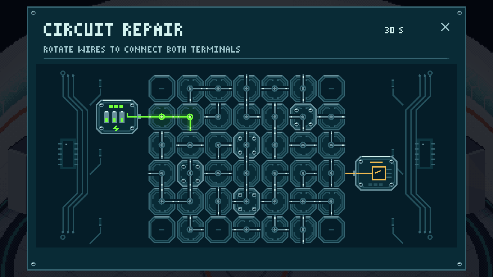
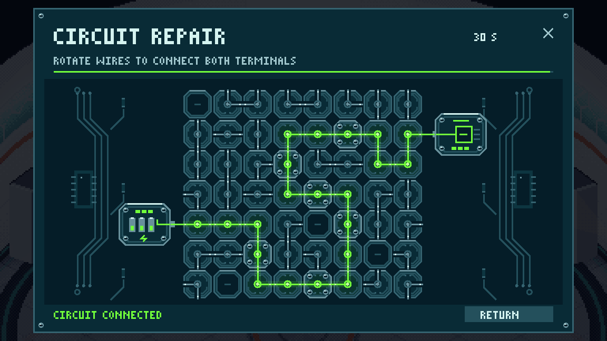
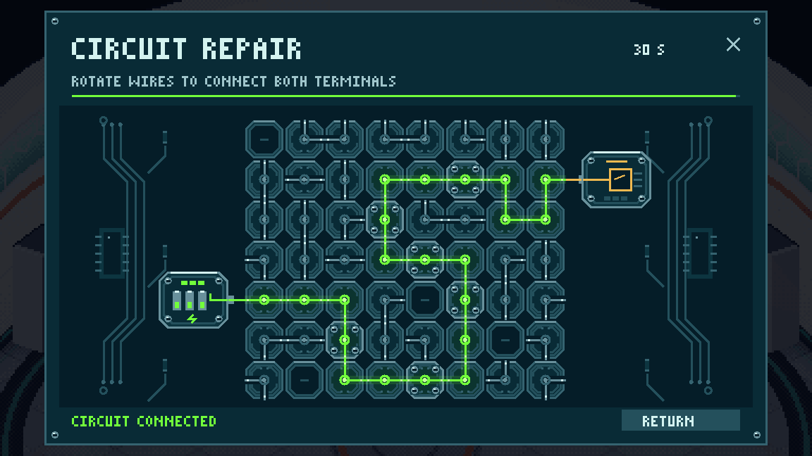

# Circuit repair visual direction

## Native presentation

A front-on maintenance panel overlays the paused game at its 384 × 216 logical viewport.
It uses the existing 3 × 5 PixelFont, integer-scaled pixels, a deep blue-green recess,
cyan-grey metal edges, neon green power and amber for the disconnected output/countdown
warning. The owner explicitly requested this palette for the circuit panel.

Visible copy is limited to **Circuit repair**, **Rotate wires to connect both terminals.**,
the countdown, close control and brief changed/connected feedback. Completion adds Return.
No module identifiers, grid counts, legend, voltage readouts or puzzle navigation appear.

## Hardware detail

- Eight-sided housings with flat connection edges and clipped corners.
- Raised outer rim, recessed inner octagon and a highlight along the top edge.
- Etched corner traces, solder vias and small surface components.
- Circular contact rings and bright connector sleeves along each wire.
- Four metal bolt heads on mounting tabs for fixed modules; no padlock icon.
- Decorative parallel buses, controller chips, pin legs and components outside the grid.
- Larger source module: three charged capacitors, a feed bus, charge LEDs and a power mark.
- Larger receiving module: input socket, relay contact, cooling fins and status LEDs.

Keep inactive details quieter than the route. Power state changes the wire and inner face;
bolt placement remains independent. Blank plates share the octagonal shape without ports.
Keyboard/pointer focus brightens the housing edge. Quarter-turn motion lasts 150 ms, while
logical connectivity updates immediately.

## Completion motion

After the last turn settles (150 ms), a bright green packet travels along the actual
connected route for 1.6 seconds. Its tail follows every corner, including fixed modules
and valid alternate routes. The receiver stays amber until the packet arrives, then its
relay closes, three status LEDs illuminate and a 450 ms rim pulse settles to steady green.
The effect plays once per completion. Repair credit and Return are available immediately;
Esc can skip the presentation. Opening an already solved board does not replay it.

The browser follows the OS reduced-motion preference; native repair accepts
`--reduced-motion`. Both give immediate receiver activation without travelling motion.
The native flow timeline is separate from puzzle rules and repair state.

## Colors

| Role | Native color |
| --- | --- |
| Board recess | `#051d28` |
| Panel / inner face | `#092b36` |
| Metal housing | `#0d3540` |
| Edge | `#356370` |
| Etched trace | `#24505c` |
| Idle wire | `#68909b` |
| Connected wire | `#72ff3b` |
| Main text | `#d4f3f0` |
| Secondary text | `#9fc5cb` |
| Warning / open output | `#efb950` |

The browser expresses the same family with OKLCH tokens and SVG housings. Its viewport can
expand; narrow screens scroll only the board to retain 44 px targets. Reduced motion removes
rotation transitions. Native boards use 19–22 logical px cells depending on row count.

## World feedback

Local repair bars sit above the two actual machines. Their positions come from generated
map metadata. Each bar shows the machine name, percentage and a midpoint notch for the two
repair stages. After wiring, 50% and Cracks pending communicate the unfinished repair.

