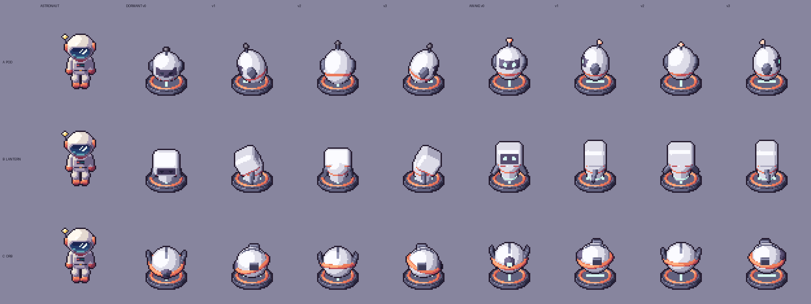

# The base bot: design

Status: **approved and built** on `feature/bot` (2026-10-12, AGENTS.md §12). Look A (pod) is the
default; B and C are kept as `BOT_DESIGN`. Every name is a placeholder in `data/bot_story.json`,
the one place to change them. Values the team must still fill in are marked **TBD**. Ideas for
what else it could do are at the end, for the team meeting: none of them are approved or built.

## Why

The player came through the airlock into storage with the power and oxygen rooms open on either
side and nothing to say what the base is or what to do. A guide fixes that, and gives the base a
history: someone lived here before you.

## What the player does

1. **Arrive.** The airlock opens into storage. The corridors to the power and oxygen rooms are
   sealed by bulkheads (red lamps, a hazard stripe; walk up and SEALED shows).
2. **Find the bot.** It sits slumped in its charging cradle on storage's south-west floor, dark.
   With the multitool out, the tool's job icon shows **fix** (cyan) over it.
3. **Wake it.** Hold F (gamepad X) for 2.4 s, the existing fix job. It boots: its eyes flicker
   on and it rises out of the cradle into a slow hover.
4. **Mistaken identity.** It greets you by the previous owner's name (TBD). You correct it in a
   name entry: keyboard typing, or a letter grid on a gamepad. From then on it uses your name,
   and remembers it across launches.
5. **Reserve power.** It switches the base to reserve power: the emergency lines flicker on,
   the bulkhead lamps turn from red to cyan, and both bulkheads open.
6. **Objectives.** **RESTORE POWER** (the reactor fully repaired: cracks and wiring) and
   **RESTORE OXYGEN** (the O2 generator fully repaired), in either order, in a small list under
   the time panel.
7. **It comes with you.** It leaves the cradle and follows you round the base (inside only).
   Turn to face it close up and `[F] TALK` shows: lore as you make progress, a reminder of what
   is left, a little trivia.

## Controls

No new buttons. Everything uses existing actions:

| What | Keyboard | Gamepad | Notes |
|---|---|---|---|
| wake the bot | hold F, tool out | hold X | the existing fix job |
| talk | F | X | only when you face it close up, and never while a door, machine, window or tool target has F |
| next line / skip typing | F, Enter, Space | A, X | Esc / B closes a conversation you started |
| name entry | type A-Z 0-9 space -, Backspace, Enter | d-pad over a letter grid, A types, B deletes, Start confirms | 12 characters at most; prefilled with the saved name |

Dialogue and name entry pause the world, like the backpack. F / X must be released after
closing before it works on the world again (the existing release guard).

## Where it lives

- **Its cradle** is baked into storage, the room you enter first: a dark steel plinth with a
  coral ring on the clear south-west floor, its cable run to a socket in the wall behind it.
  (A first version gave the bot a room of its own, south of storage; the team found that a room
  just for the bot made no sense, so it was removed.)
- **Bulkheads:** generated from existing primitives and ramps (steel, white, coral, the hazard
  stripe, red/cyan lamps). The leaves are animated sprites, sealed → open. While sealed, the
  corridor is blocked at run time (`MapTerrain.blockers`); the walk grid itself stays walkable.
- **Reserve power:** a generated per-view overlay (the emergency lines and floor rings) faded in
  additively with a short flicker. The overworld base stays dead outside.

## The bot

- **Look:** generated with the existing SDF renderer, in the base's own materials: glossy white
  shell, coral strip, a dark visor with a screen-cyan face, small and rounded, about 0.6× the
  astronaut's height. Its eyes stay lit at night. The three looks the team chose from (the real
  astronaut for scale, then dormant and awake from all four sides):
  - **A, Pod** (the default): an egg with a visor, small side pods, an antenna whose tip lights.
  - **B, Lantern:** a rounded screen-head on a tapered body, stub arms, a cyan thruster ring.
  - **C, Orb:** a sphere with a coral ring round its waist and one big lens eye.

  
- **Eight facings,** like the astronaut, drawn once: the camera turns but the light stays put on
  screen, so each facing looks right from every side.
- **Animations:** dormant (slumped, dark), wake (eyes flicker on, it rises), idle (a slow
  hover-bob and a blink), talk (the face pulses), move (leaning into its flight).
- **Following** (indoors only): it hovers to a spot behind and beside you, up to running speed,
  steering round walls and anything solid; it is never solid itself. Stuck, or left far behind,
  it blinks back in beside you. When you go outside it waits in the base, and meets you at the
  airlock when you come back.

## Text

All text is PixelFont, in capitals (PixelFont gained `.` `,` `?` `!` `'`). Dialogue sits on a
plate above the hotbar in the time panel's style (§7.5), the speaker's name on a tab. Text types
out with a synthesised chirp every few letters.

### Draft dialogue

`[OWNER]` is the previous owner's name (TBD), `[NAME]` the player's. All lines live in
`data/bot_story.json`, not in code.

- **Wake:** "SYSTEMS... ONLINE." / "UNIT REPORTING. WELCOME BACK, [OWNER]." / "YOU WERE GONE 412 DAYS."
- **Correction** (the name entry opens): "...YOU ARE NOT [OWNER]? THEN WHO ARE YOU?"
- **Named:** "[NAME]. LOGGED." / "SORRY, [NAME]. THE LAST FACE I SAW HERE WAS [OWNER]'S."
- **Reserve power:** "MAIN POWER IS DOWN. SWITCHING TO RESERVE." / "BULKHEADS OPEN."
- **Objectives:** "THE REACTOR IS CRACKED AND THE O2 GENERATOR IS DEAD." / "FIX BOTH, [NAME]. YOU WILL FIND SCRAP NEAR THEM."
- **Lore**, unlocked by triggers:

  | Trigger | Line (draft) |
  |---|---|
  | power done | "REACTOR STABLE. [OWNER] BUILT THAT CORE BY HAND. IT NEVER FAILED BEFORE." |
  | oxygen done | "AIR IS CLEAN AGAIN. THE O2 ROOM WAS SEALED THE NIGHT [OWNER] LEFT." |
  | panes done | "THE STORAGE GLASS IS WHOLE. IT BROKE OUTWARD. SOMETHING HIT IT FROM INSIDE." |
  | both done | "MAIN SYSTEMS NOMINAL. THE SOLAR FIELD OUTSIDE STILL NEEDS ALIGNING." |
  | talk again | trivia about the planet, one per talk, no repeats |

## The objective line

One small list under the time panel, top left, in both scenes, done objectives ticked, dimmed
and struck through. It hides during cutscenes and pauses, avoids the movable survival panel, and
goes 6 s after everything is done. Approved as an addition to the compact HUD (§9).

## Sound

Synthesised, non-musical, inharmonic (§7.6): `bot_boot` (the wake, timed to the animation),
`bot_chirp` (five variants, as it types), `bot_hover` (a quiet loop while it follows) and
`reserve_on` (relay clunk and the hum stuttering on with the lights). The bulkheads reuse the
airlock's `door_unseal`; a recorded sound of their own needs the source packs and `ffmpeg`.

## State

- **`GameState.story`** (session): bot awake, named, reserve power, objectives given, lore heard,
  where the bot was last.
- **`user://profile.cfg`**: the player's name - a preference like the survival HUD layout, not
  a save file.

## TBD from the team

- The bot's name.
- The previous owner's name, and how the bot refers to them.
- The final lines and lore.

## Ideas for the team meeting

What else the bot could do. Nothing here is approved or built. Size is a rough guide: **S** a
day or so, **M** a few days, **L** a week or more. "Rules" notes anything that needs the owner
(AGENTS.md §9, §10) or touches the multitool's jobs.

| Idea | What the player sees | Size | Rules |
|---|---|---|---|
| **Point the way** | It flies a little ahead toward the next unfinished machine; a small arrow at the screen edge when the target is off screen. | M | A new HUD pointer needs approval (§9). |
| **Contextual barks** | Short speech bubbles that don't pause anything, at the moment they matter: "NEED 3 SCRAP" at a machine, "SUIT RESERVE LOW" in the O2 room, "BAG FULL", "A PANE IS IN REACH". | M | New UI element; lines live in `bot_story.json`. |
| **Salvage scan** | On command, a ring pings out and briefly outlines nearby scrap, glass and rations, even through walls. | M | Needs a button: F/X is taken, so this means a new action (proposal, §10.1). |
| **Night light** | After dark its eye lamp lights a soft pool round it, like the astronaut's own light. | S | Fits the day/night rules (§4.4). |
| **Hazard warnings** | It flashes and chirps at unsafe air, low vitals, or the cargo box about to give way. | S–M | Reuses survival state; no new HUD. |
| **Repair helper** | After many turns without solving a circuit it lights up one correct module; it holds a light over the glass jigsaw. | M | Changes puzzle difficulty; owner call. |
| **Lore log** | A panel that replays the lines you have heard, so story isn't missed. | M | New UI panel (approval). |
| **Map marks** | Objectives and salvage it has seen appear on the M map. | M | Extends the map screen. |
| **Rescue** | When the suit fails, the bot is what brings you back (it carries you to the spawn). | M | Changes the rescue flow (survival). |
| **Its own repairs** | The bot is damaged too; fixing its parts (with the existing jobs) unlocks these abilities one by one. | L | A progression system: proposal first. |
| **Outdoors** | Once the base is powered, it follows you out: the solar field, the comms beacon. | L | Overworld depth, plants, terrain heights and the airlock cutscene; big. |
| **Personality** | It goes back to its cradle to sleep at night, has idle quirks, reacts to dawn and dusk. | S–M | Animation and data only. |
