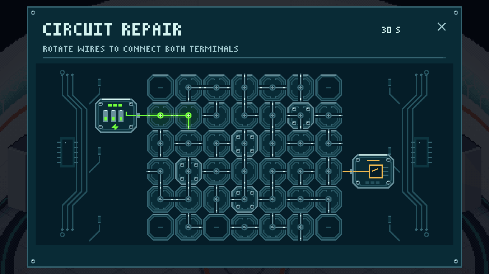
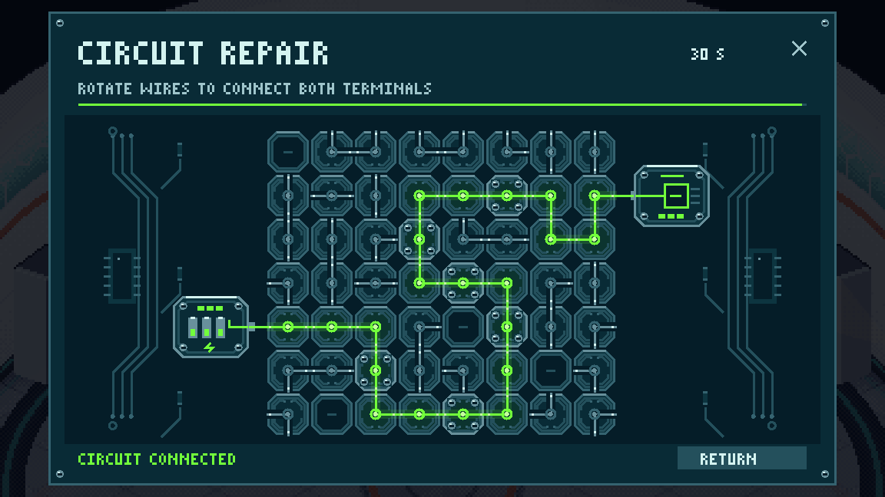
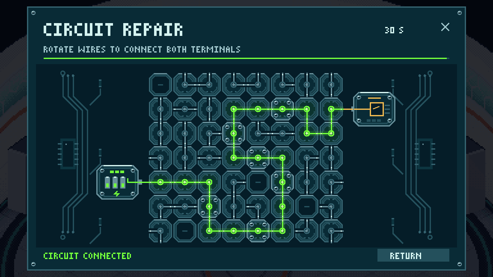
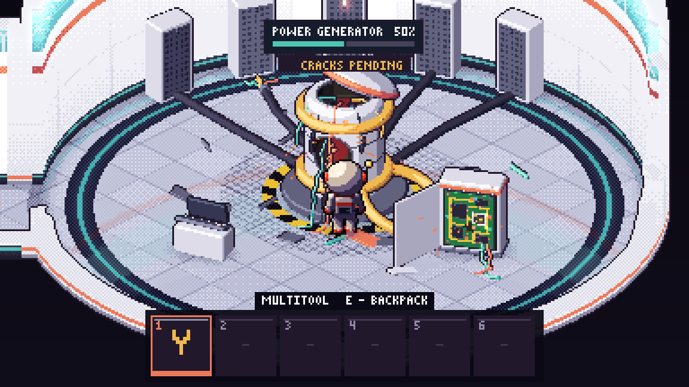

# Circuit repair — implementation notes

Approach either the power generator or O2 generator inside the base and press F/X. The
world pauses, and a native maintenance panel asks the player to rotate wires to connect
both terminals. Some wires are bolted in place and carry power without rotating.

## Rules and timing

North/east/south/west ports use bits 1/2/4/8. Only orthogonally adjacent, reciprocally facing
ports connect. A traversal from the fixed supply marks powered modules. Completion requires
reaching the output with an east-facing port; unrelated wires and disconnected loops need
not align. Alternate valid routes are accepted. All modules are preplaced.

Each machine owns five distinct authored routes. Movable orientations are shuffled; fixed
wires retain their correct orientations. Starts are guaranteed unsolved and solvable.
At 30 active seconds, an unsolved board advances to the next layout and resets the timer.
After the fifth it wraps to the first with a fresh shuffle. Timeout gives no repair credit.
Closing preserves orientations and pauses time. Completing one circuit stops the task.

| Machine | Layout grids | Fixed wires per layout |
| --- | --- | --- |
| Power | 7×6, 7×7, 8×6, 8×7, 8×7 | 4, 5, 5, 6, 6 |
| O2 | 7×6, 7×6, 8×6, 8×7, 7×6 | 3, 3, 3, 6, 5 |

The counts are authoring information, never displayed in the panel.

## Controls

| Input | Action |
| --- | --- |
| F / gamepad X near a machine | Open circuit repair |
| Left click / Enter / Space / F / gamepad A | Turn clockwise |
| Right click / Q / gamepad left shoulder | Turn counterclockwise |
| Arrows / WASD / d-pad | Select movable modules, skipping bolts and plates |
| Esc / gamepad B / close / Return after success | Close and resume the world |

The panel consumes input so inventory, hotbar, movement, map, camera and tool actions do not
fire behind it. F/X must be released after closing. Machine proximity suppresses the tool
independently of the airlock and inventory guards.

## Progress and extension point

GameState owns the session state independently for power and oxygen. Wiring accounts for
50% of repair. The future cracks task can call:

```gdscript
GameState.repair_for("power").complete_task("cracks")
```

This awards the other half once; unknown tasks and repeated credit are rejected. Overall
repair bars remain at 50% after wiring until that task exists. Generated broken art and fault
FX are unchanged; restored assets and their effects are future work. Scene transitions keep
progress, orientations and remaining time; restarting the game resets session state.

## Code ownership

| File | Responsibility |
| --- | --- |
| `data/repair_circuits.json` | Shared authored catalog: routes, blanks, fixed wires and machine sequences |
| `scripts/repair/circuit_catalog.gd` | Catalog loading and orthogonal route expansion |
| `scripts/repair/circuit_puzzle.gd` | Pure masks, rotations, shuffling and connection traversal |
| `scripts/repair/machine_repair.gd` | Countdown, layout cycling and idempotent task progress |
| `scripts/repair/circuit_repair_ui.gd` | Native octagonal panel, detail, input and turn animation |
| `scripts/repair/circuit_power_flow.gd` | View-only completion timeline and distance sampling through wire corners |
| `scripts/repair/machine_repairs.gd` | World proximity, modal ownership and local machine bars |
| `scripts/game_state.gd` | Cross-scene session lifetime |
| `tools/interior_gen.py` | Machine interaction/bar anchors derived from actual model centres |
| `tools/wire_repair_preview.js` | Browser view, input and countdown companion |
| `tools/wire_repair_core.js` | Browser pure model; consumes the shared catalog |

`interior_gen.py --repair-metadata-only` refreshes anchors without rerendering the map.
Regenerating the whole interior also exports them. No map pixel positions live in gameplay
code. Native and browser shuffles may differ, but both use the same ten circuit definitions.

## Verification

```powershell
godot --headless --path . res://tests/repair_test.tscn
godot --headless --path . res://tests/inventory_test.tscn
godot --headless --path . res://scenes/interior.tscn --quit-after 300
godot --headless --path . res://scenes/overworld.tscn --quit-after 300 -- --no-intro
node tools/test_wire_repair.cjs
```

Native repair tests passed 9,677 checks over 1,000 shuffled boards and actual keyboard,
pointer and gamepad events. They verify immutability, completion, timeout/wrap, closed
countdowns, independent state, reachable machine fronts, projected bar anchors, input
ownership and scene persistence. Inventory regression passed 98 checks. Both scenes ran
without errors or warnings. Browser model tests passed 1,000 shuffles.
Animation checks also cover actual/alternate routes, sampling through corners, receiving
power only on arrival, one-time credit/effect and reduced motion. Browser controls verified
charging-to-powered feedback and closing/resuming during the effect. At 375 px the page has
no horizontal overflow, wires retain 44 px targets, and only the board pans sideways.

`tests/repair_gallery.tscn -- --out=ABSOLUTE_DIRECTORY` captures all ten real native layouts
and two solved panels. Screenshots were checked at logical pixel size and enlarged; all
modules, terminals, bolts and text fit. Native screenshots below also show actual world bars.
The gallery also records both native completion flights; `circuit-power-flow.gif` is a
looping preview of the one-time in-game effect.







