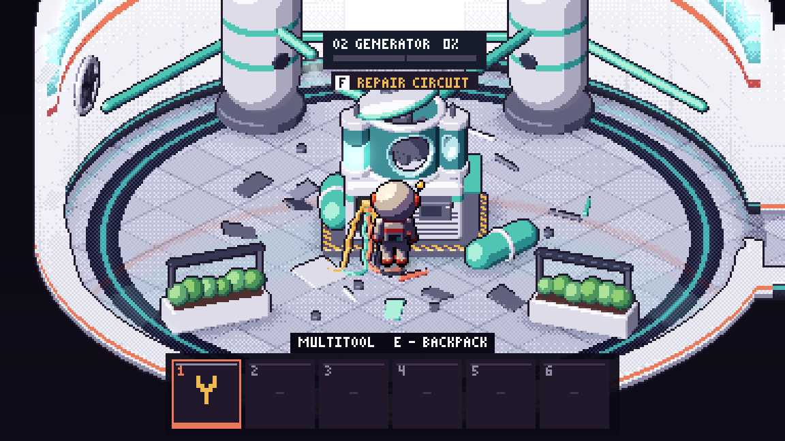
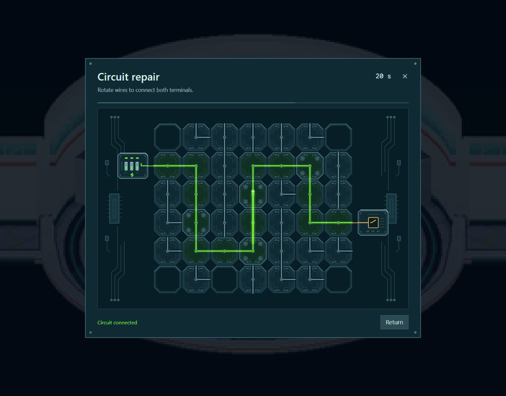

# Circuit repair — implementation notes

Approach either generator inside the base with three scraps and press F/X. The world pauses
for full-screen Crack Repair first: place three scrap patches over holes/fractures and weld
their perimeters on the owner's exact supplied Power/O2 panel images. The original PNGs are
unchanged; the UI displays the wall crop with the existing holes. The teal frame, small red/gold
torch and pale silver scrap palette follow the approved draft; scraps are enlarged 12%.
Successful welding spends three scraps and unlocks this circuit panel.
Rotate wires to connect both terminals; bolted wires carry power without rotating.

## Rules and timing

North/east/south/west ports use bits 1/2/4/8. Only orthogonally adjacent, reciprocally facing
ports connect. A traversal from the fixed supply marks powered modules. Completion requires
reaching the output with an east-facing port; unrelated wires and disconnected loops need
not align. Alternate valid routes are accepted. All modules are preplaced.

Each machine owns five distinct authored routes. Movable orientations are shuffled; fixed
wires retain their correct orientations. Starts are guaranteed unsolved and solvable.
At 30 active seconds, an unsolved board advances to the next layout and resets the timer.
After the fifth it wraps to the first with a fresh shuffle. Timeout gives no repair credit.
Closing preserves orientations and pauses time. Completing one circuit stops the task.

| Machine | Layout grids | Fixed wires per layout |
| --- | --- | --- |
| Power | 7×6, 7×7, 8×6, 8×7, 8×7 | 4, 5, 5, 6, 6 |
| O2 | 7×6, 7×6, 8×6, 8×7, 7×6 | 3, 3, 3, 6, 5 |

The counts are authoring information, never displayed in the panel.

## Controls

| Input | Action |
| --- | --- |
| F / gamepad X near a machine | Open cracks first, then circuit repair |
| Left click / Enter / Space / F / gamepad A | Turn clockwise |
| Right click / Q / gamepad left shoulder | Turn counterclockwise |
| Arrows / WASD / d-pad | Select movable modules, skipping bolts and plates |
| Esc / gamepad B / close / Return after success | Close and resume the world |

The panel consumes input so inventory, hotbar, movement, map, camera and tool actions do not
fire behind it. F/X must be released after closing. Machine proximity suppresses the tool
independently of the airlock and inventory guards.

## Progress and restoration

GameState owns independent session state for power and oxygen. Cracks account for 50% and
wiring for the other 50%. The crack panel calls:

```gdscript
GameState.repair_for("power").finish_cracks()
```

This requires three individually sealed perimeters (95% each) and consumes three scraps
atomically. Placement covers the entire hole/fracture contour with a 2px margin. Welding is
untimed, with fast-stroke gaps and local overheating after about three seconds of lingering.
Lifting cools quickly; melt damage is confined to a smaller spot. Rounded raised filler and
crescent ridges follow actual hand strokes, cooling from red to grey steel. Sealed scraps
glow teal for one second.
Failed/unfinished attempts and closes lose no resources. Circuit rotation and its countdown
are blocked until cracks are complete. Progress, placements, welds, orientations and remaining
time survive scene transitions; restarting resets the session.

Completing both tasks replaces the broken machine with restored generator geometry, including
its loose parts, depth map, walk grid, light masks and fault emitters.
Power's restored assembly also reconnects the torn battery cable and closes the service
cabinet, removing the exposed burnt board and dangling leads automatically.
`interior_gen.py` writes all four headings into `repaired_power`, `repaired_oxygen` and
`repaired_both`. The room keeps
its shared MapTerrain instance when switching variants, so player/tool/camera references and
world positions stay consistent. Six gatherable scraps inside the base use existing prop art.
`make interior` also checks physical cable continuity and service-cover closure through
`tests/test_power_restore.py`.

## Code ownership

| File | Responsibility |
| --- | --- |
| `data/repair_circuits.json` | Shared authored catalog: routes, blanks, fixed wires and machine sequences |
| `scripts/repair/circuit_catalog.gd` | Catalog loading and orthogonal route expansion |
| `scripts/repair/circuit_puzzle.gd` | Pure masks, rotations, shuffling and connection traversal |
| `scripts/repair/machine_repair.gd` | Countdown, layout cycling and idempotent task progress |
| `scripts/repair/crack_puzzle.gd` | Hole coverage, placement, welding, heat and transient seal state |
| `scripts/repair/crack_repair_ui.gd` | Full-screen flat casing view, scrap tray, torch and sparks |
| `scripts/repair/circuit_repair_ui.gd` | Native octagonal panel, detail, input and turn animation |
| `scripts/repair/circuit_power_flow.gd` | View-only completion timeline and distance sampling through wire corners |
| `scripts/repair/machine_repairs.gd` | World proximity, modal ownership and local machine bars |
| `scripts/game_state.gd` | Cross-scene session lifetime |
| `tools/interior_gen.py` | Machine anchors, flat inspection walls and restored room variants |
| `tools/wire_repair_preview.js` | Browser view, input and countdown companion |
| `tools/wire_repair_core.js` | Browser pure model; consumes the shared catalog |

`interior_gen.py --repair-metadata-only` refreshes world anchors without rerendering the map.
`--repair-panels-only` refreshes `repair_panel` metadata (`file`, logical `size`, local `sites`,
`view`, `design`). `REPAIR_PANEL_DESIGN=reference` is the default: the owner-supplied originals
under `machines/reference/` are never overwritten. `source_rect` selects the wall;
`baked_damage` skips duplicate procedural holes; `damage_samples` measures the original
holes/rims and `sha256` identifies each source. `equipment`, `detailed` and `simple` retain
the earlier generated walls. Regenerating the whole
interior exports both sets of data. No map pixel positions live in gameplay
code. Native and browser shuffles may differ, but both use the same ten circuit definitions.

## Verification

```powershell
godot --headless --path . res://tests/repair_test.tscn
godot --headless --path . res://tests/inventory_test.tscn
godot --headless --path . res://scenes/interior.tscn --quit-after 300
godot --headless --path . res://scenes/overworld.tscn --quit-after 300 -- --no-intro
node tools/test_wire_repair.cjs
```

Native repair tests cover over 9,700 checks over 1,000 shuffled boards and actual keyboard,
pointer and gamepad events. They verify immutability, completion, timeout/wrap, closed
countdowns, independent state, reachable machine fronts, projected bar anchors, input
ownership and scene persistence. Inventory regression passed 98 checks. Both scenes ran
without errors or warnings. Browser model tests passed 1,000 shuffles.
Animation checks also cover actual/alternate routes, sampling through corners, receiving
power only on arrival, one-time credit/effect and reduced motion. Browser controls verified
charging-to-powered feedback and closing/resuming during the effect. At 375 px the page has
no horizontal overflow, wires retain 44 px targets, and only the board pans sideways.

`tests/repair_gallery.tscn -- --out=ABSOLUTE_DIRECTORY` captures all ten real native layouts
and two solved panels. Screenshots were checked at logical pixel size and enlarged; all
modules, terminals, bolts and text fit. Native screenshots below also show actual world bars.
`tests/crack_gallery.tscn` records native pointer welding, cooling/glow frames and restored
machines in all four headings by day and night. The circuit gallery also records both native
completion flights; `circuit-power-flow.gif` is a
looping preview of the one-time in-game effect.




